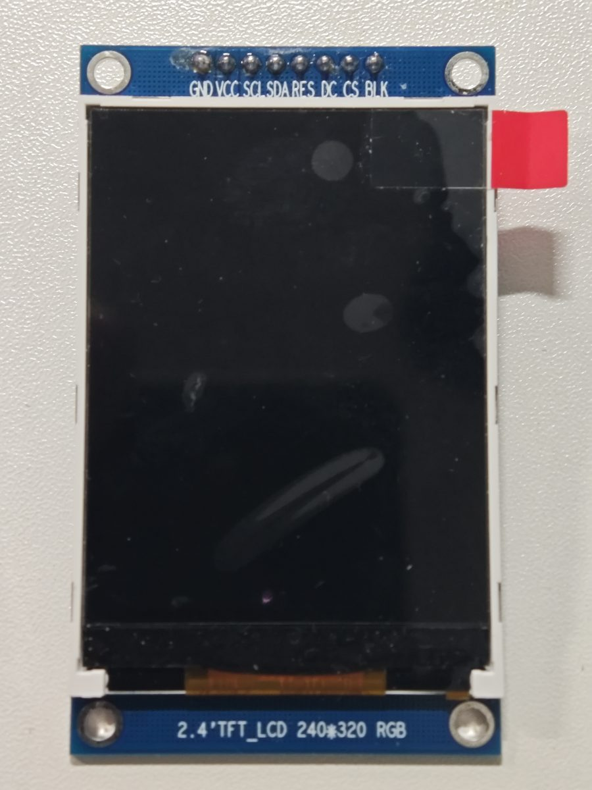
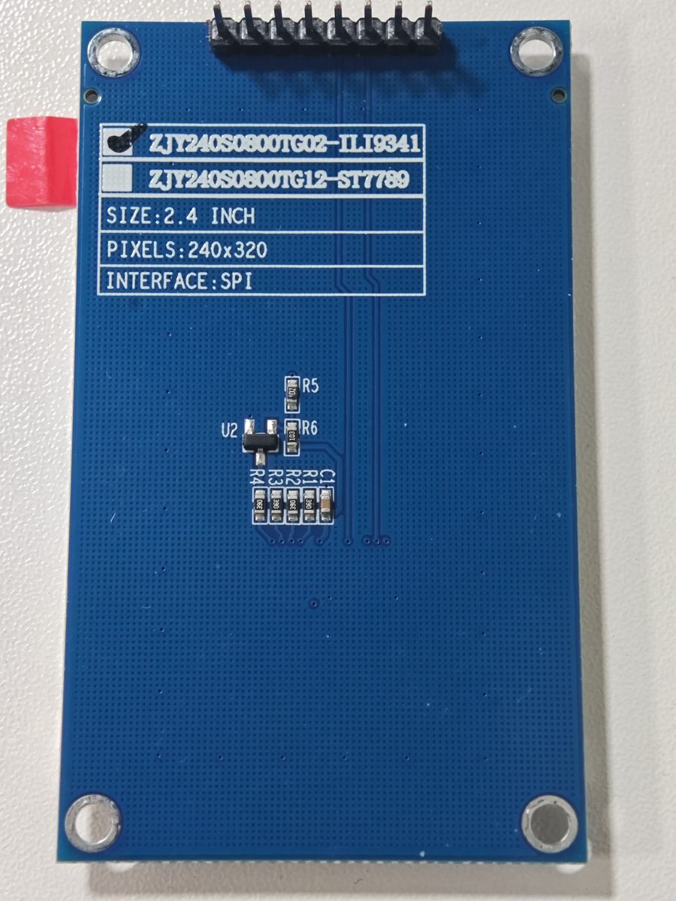

[English](README.md) | [简体中文](README.zh-CN.md)

[](https://github.com/Lissa7zz/stm32g474-ili9341/actions/workflows/build.yml)

# STM32G474 NUCLEO + ILI9341

An STM32CubeIDE example that drives an 8-pin ILI9341 display from a
NUCLEO-G474RE over SPI1.

The project uses a `320 x 240` landscape RGB565 image and displays a built-in
demo image at startup. Images and headers can be prepared with
[Pixel2Panel](https://lissa7zz.github.io/ili9341-image-studio/).


## Hardware

- NUCLEO-G474RE with an STM32G474RET6 MCU
- `ZJY240S0800TG02-ILI9341` 2.4-inch, 240 x 320 SPI display module
- ILI9341 SPI display with the common 8-pin interface:
  `GND / VCC / SCL / SDA / RES / DC / CS / BLK`
- ST-LINK USB cable and jumper wires

## Wiring

| ILI9341 | STM32 | Arduino signal | Nucleo header | Configuration |
|---|---|---|---|---|
| GND | GND | GND | CN6 pin 6 or 7 | Common ground |
| VCC | 3V3 | 3V3 | CN6 pin 4 | Use the display module's rated voltage |
| SCL | PA5 | D13 | CN5 pin 6 | SPI1_SCK |
| SDA | PA7 | D11 | CN5 pin 4 | SPI1_MOSI |
| RES | PA8 | D7 | CN9 pin 8 | GPIO output, initially high |
| DC | PA9 | D8 | CN5 pin 1 | GPIO output, initially low |
| CS | PB6 | D10 | CN5 pin 3 | GPIO output, initially high |
| BLK | PB10 | D6 | CN9 pin 7 | Current firmware drives it high to enable the backlight |

Notes:

- Connect VCC to 5 V only when the display module explicitly supports 5 V.
  SPI and GPIO signals must remain at 3.3 V.
- Do not power a backlight LED directly from a GPIO if BLK exposes the LED
  path. Use a series resistor or a transistor/MOSFET driver.
- PA5 is also connected to onboard user LED LD2 by default. Consider removing
  SB6 if the SPI clock is unstable at higher speeds.
- PB10 is configured as a GPIO output for the current on/off backlight control.
  PWM dimming is not implemented yet.

### Hardware photos

| Front | Back |
|---|---|
| [](docs/images/ili9341-front.jpg) | [](docs/images/ili9341-back.jpg) |

## CubeMX configuration

MCU: `STM32G474RETx`. Board: `NUCLEO-G474RE`.

| Setting | Current value |
|---|---|
| Debug | Serial Wire |
| SYSCLK | 170 MHz |
| Clock source | HSI 16 MHz + PLL |
| PLL | M=4, N=85, R=2 |
| SPI1 | Master, 8-bit, MSB first |
| Clock mode | CPOL low, CPHA 1 edge |
| NSS | Software |
| Prescaler | 16, approximately 10.625 MHz SPI clock |
| PA5 / PA7 | SPI1_SCK / SPI1_MOSI |
| PA8 | LCD_RST, output push-pull |
| PA9 | LCD_DC, output push-pull |
| PB6 | LCD_CS, output push-pull |
| PB10 | LCD_BL, output push-pull, initially high |

CubeMX project: [firmware/ILI9341.ioc](firmware/ILI9341.ioc).

## Open and flash

1. Import the project under `firmware` into STM32CubeIDE.
2. Build the project.
3. Flash it to the NUCLEO-G474RE through the onboard ST-LINK.
4. The display should show the landscape demo image in
   `assets/demo-preview.png`.

Local build artifacts such as `Debug` are not committed. Rebuild after the
first import.

### CMake build

```bash
cmake -S . -B build -G Ninja \
  -DCMAKE_TOOLCHAIN_FILE=cmake/arm-none-eabi.cmake \
  -DCMAKE_BUILD_TYPE=Release
cmake --build build
```

This produces `build/stm32g474_ili9341.elf` and `.bin`.

## Code layout

- `firmware/Core/Src/main.c`: application entry and demo image display
- `firmware/Core/Src/ili9341.c`: reusable ILI9341 driver
- `firmware/Core/Inc/ili9341.h`: public display driver API
- `firmware/Core/Src/spi.c`: SPI1 configuration
- `firmware/Core/Src/gpio.c`: CubeMX GPIO initialization
- `firmware/Core/Inc/ili9341_image.h`: demo image size and array declaration
- `firmware/Core/Src/ili9341_image.c`: 320 x 240 RGB565 demo image

`ILI9341_DrawRGB565Image()` accepts the image pointer, byte length, width, and
height. The byte length must equal `width * height * 2`.

## Replacing the demo image

Convert an image with
[Pixel2Panel](https://lissa7zz.github.io/ili9341-image-studio/), then replace:

- `firmware/Core/Inc/ili9341_image.h`
- `firmware/Core/Src/ili9341_image.c`

The repository demo can also be regenerated:

```bash
python -m pip install -r tools/requirements.txt
python tools/generate_demo_header.py
```

## Board documentation

- [ST UM2505: STM32G4 Nucleo-64 boards](https://www.st.com/resource/en/user_manual/um2505-stm32g4-nucleo64-boards-mb1367-stmicroelectronics.pdf)

## Related project

- [Pixel2Panel image converter](https://github.com/Lissa7zz/ili9341-image-studio)

## Developer

- Developer: Lissa7zz
- AI collaboration: OpenAI Codex
- Contact: [millergordon72@gmail.com](mailto:millergordon72@gmail.com)

## License

Copyright (C) 2026 Lissa7zz

Original project code, documentation, and the generated demo image are
released under the [MIT License](LICENSE). You may copy, modify, and distribute
them under its terms.

The software is provided "AS IS", without any express or implied warranty.
STM32 HAL and CMSIS components remain under their own licenses. See
[NOTICE.md](NOTICE.md).

---

<p align="center"><em>كأن قلبي لم يعد ينبض؛ والريح الباردة تطلق تنهداتها — سانتاباد.</em></p>
